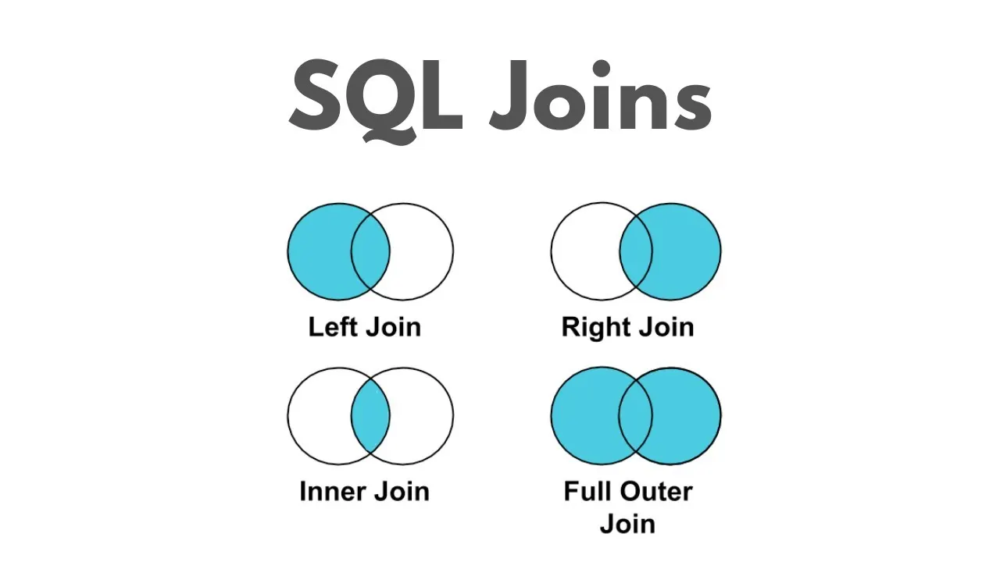

# Joins & Relational Data {#sec-joins}

```{r}
#| include: false
library(tidyverse)
```

*From the 10/21–10/22 in-class activity (Day 7)*

A join is a decision about which records belong together, not just a line of code. Before joining, ask:

1.  What does **one row** represent in each table?
2.  What makes two records a **valid match**?
3.  After joining, does the result still answer my question? (Check the row count and what one row now means.)

[{fig-align="center" width="591" height="332"}](https://medium.com/@gajendrasharmawork/understanding-sql-joins-left-join-right-join-and-union-explained-11de9a80522c)

## Quick Reference

| Function | Keeps which rows? | Adds columns from `y`? | Use it to... |
|:----------------|:----------------|:----------------|:----------------------|
| `left_join(x, y)` | All rows in `x` | Yes | Add lookup info to my starting table |
| `right_join(x, y)` | All rows in `y` | Yes | Same as a left join with `x`/`y` swapped |
| `inner_join(x, y)` | Only rows that match | Yes | Analyze complete matches only |
| `full_join(x, y)` | All rows from both | Yes | Reconcile/audit two sources |
| `semi_join(x, y)` | Rows in `x` with a match | No | Filter `x` to records that have a match |
| `anti_join(x, y)` | Rows in `x` with no match | No | Find what *didn't* match (diagnostics) |
| `intersect(x, y)` | Identical rows in both | No (same columns) | Rows shared by two extracts |
| `union(x, y)` | Distinct rows in either | No (same columns) | Stack two compatible tables, no duplicates |
| `setdiff(x, y)` | Rows in `x` not in `y` | No (same columns) | What was added/removed between snapshots |

- Read `x |> left_join(y, by = "id")` as "**join y to x**": `x` is the starting population
- Always write `by =` (or `join_by()`) so dplyr doesn't silently match on other columns that share a name

## Example Tables

```{r}
counties <- tribble(
  ~county_id, ~county,   ~population,
  101,        "Alder",   10000,
  102,        "Birch",   20000,
  103,        "Cedar",   15000,
  104,        "Dogwood",  8000
)

health <- tribble(
  ~county_id, ~measure,   ~estimate,
  101,        "Diabetes", 10.2,
  102,        "Diabetes", 12.5,
  103,        "Diabetes",  9.8,
  105,        "Diabetes", 14.1   # 105 isn't in counties!
)

programs <- tribble(
  ~program_id, ~county_id, ~program,
  "P01",       101,        "Walking group",
  "P02",       101,        "Nutrition class",
  "P03",       103,        "Walking group",
  "P04",       104,        "Nutrition class",
  "P05",       104,        "Nutrition class"
)
```

## Keys

| Key | Meaning | Example here |
|:---------------|:-----------------------------------|:--------------------|
| Primary key | Uniquely identifies each row; never repeated, never `NA` | `county_id` in `counties` |
| Foreign key | Points to a key in another table; may repeat | `county_id` in `programs` |
| Duplicate key | A key value in several rows: fine for a foreign key, a data problem for a primary key | `101` appears twice in `programs` |
| Surrogate key | An ID made up just to identify records | `program_id` (`"P01"`) |
| Natural key | A meaningful attribute that already identifies the thing | A state + county FIPS code |

Check that a primary key really is unique. Both of these should return **zero rows**:

```{r}
counties |> count(county_id) |> filter(n > 1)
counties |> filter(is.na(county_id))
```

!! "Unique in this file" doesn't make it a good key. `county` names happen to be unique here, but county names repeat across states.

### Relationships

| Relationship | Meaning | Example |
|:---------------|:--------------------------------|:----------------------|
| One-to-one | Each row matches at most one row on the other side | County → one population value |
| One-to-many | One row can match several rows | County → its programs |
| Many-to-many | Rows on both sides can match several rows | Students ↔ courses |

A one-to-many join **adds rows**: Alder appears twice after joining `programs` because it has two programs. State what you expect so dplyr can warn you:

```{r}
counties |>
  left_join(programs, by = "county_id", relationship = "one-to-many")
```

## Mutating Joins (add columns)

**Prediction first:** joining `health` to `counties` with a left join should keep all four counties, and Dogwood (104) should get `NA`s because it has no health row.

```{r}
counties |>
  left_join(health, by = "county_id")
```

- !! Dogwood's `NA` means **no estimate**, not a diabetes rate of zero
- County 105 is dropped because the join starts from `counties`

```{r}
# inner join: only Alder, Birch and Cedar have rows in both tables
counties |>
  inner_join(health, by = "county_id")
```

- !! An inner join silently drops unmatched rows. An average after an inner join describes **only the matched counties**.

```{r}
# full join: everything from both sides, NAs wherever there's no match
counties |>
  full_join(health, by = "county_id")
```

## Filtering Joins (keep or drop rows, no new columns)

```{r}
# Which counties HAVE a health estimate?
counties |> semi_join(health, by = "county_id")

# Which counties are MISSING a health estimate?
counties |> anti_join(health, by = "county_id")

# Which health rows point to a county we don't have?
health |> anti_join(counties, by = "county_id")
```

The two anti joins answer different questions, so the order of `x` and `y` matters.

## Set Operations (compare whole rows)

Set operations need tables with the **same columns** and compare entire rows, not a chosen key.

```{r}
fall <- tribble(
  ~student_id, ~course,
  1, "Data 200",
  2, "Data 200",
  3, "Data 232"
)
spring <- tribble(
  ~student_id, ~course,
  2, "Data 200",
  3, "Data 232",
  4, "Data 200"
)

intersect(fall, spring)  # identical rows in both terms
union(fall, spring)      # every distinct row, once
setdiff(spring, fall)    # rows new in spring
```

!! `intersect()` finds identical student-*and*-course rows. To find students enrolled in both terms *regardless of course*, compare just the key: `fall |> semi_join(spring, by = "student_id")`.
